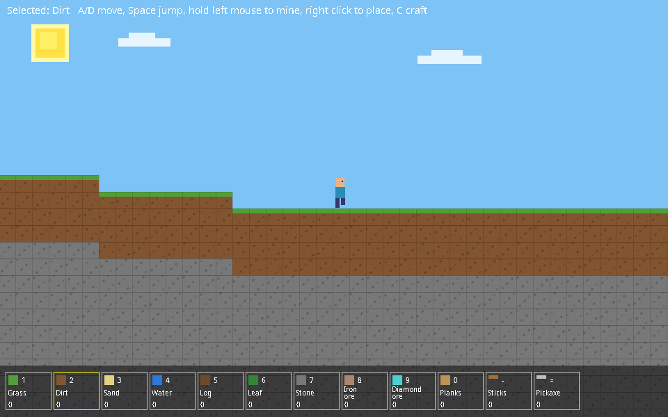

# 2D Minecraft

This game is a 2D version of minecraft, its pretty bad.

You can also compile and run it from a terminal:

    javac -d bin src/Game.java
    java -cp bin Game

Controls:
A/D or arrow keys to move, Space to jump. 
Hold left click to mine and right click to place a block. 
Pick an item with 0-9, and use - for sticks, and = for the pickaxe. 
Press C to craft. Then click a recipe or press P for planks, S for sticks, or K for a pickaxe.

